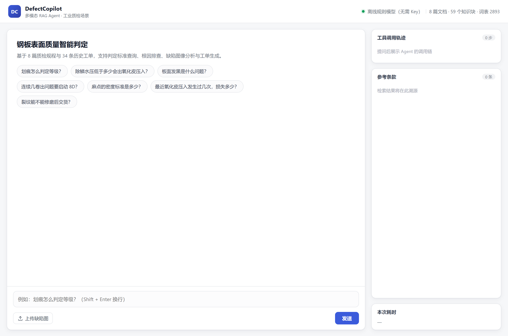
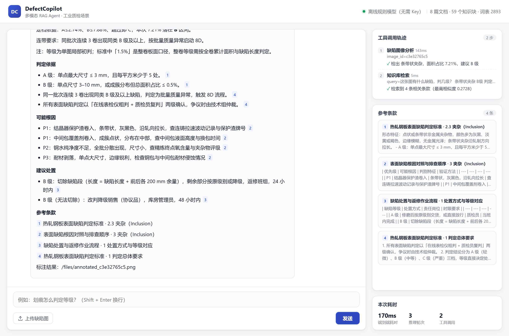
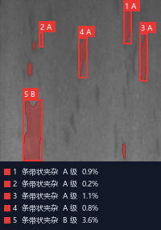
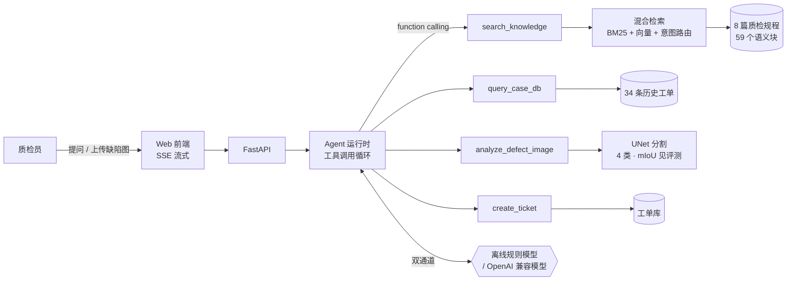

# DefectCopilot

**面向工业质检场景的多模态 RAG Agent 应用框架** —— 上传一张钢板表面缺陷图，系统完成分割定位 → 面积与等级判定 → 检索工艺规程与历史工单 → 给出根因与处置建议 → 一键生成质量工单。

> 核心引擎与业务域解耦：检索、Agent 循环、评测三层不依赖「钢板」这个领域，换一套语料与工具就是另一个行业的助手。工业质检只是第一个落地的 domain pack。

| 提问 / 上传缺陷图 | Agent 检索规程与历史工单并给出结论 | 标注图（按类别着色，序号对应图例） |
| :---: | :---: | :---: |
|  |  |  |

上面均为真实运行截图（`docs/screenshots.js` 可重新生成）。**clone 即可运行**：权重已随仓库提供（30 MB），无 API Key 时用离线规则模型完整演示，详见 [快速开始](#5-快速开始)。

---

## 1. 要解决的问题

产线上的真实断点不是「检测不出缺陷」——CV 模型已经能框出缺陷位置，但它回答不了质检员真正要处理的三件事：

1. **这卷判几级？** 判定标准是一份 20 页的规程，A/B/C 三档阈值分散在六个缺陷类型下，靠人记。
2. **为什么会出这个缺陷？** 根因排查要按「设备→工艺→原料」的顺序验证，新人容易漏项。
3. **现在该切、该降级还是该判废？** 处置方式直接对应损失金额，判错就是几万块。

所以本项目把 CV 模型当成**一个工具**接进 Agent，让它去查规程、查历史、算等级、出工单——模型负责「看见」，Agent 负责「判断」与「举证」。

图像侧的输出除了结论，还会生成一张**按缺陷类别着色**的标注图：每类缺陷一个固定颜色（夹杂红 / 斑块橙 / 划痕蓝），分割掩码半透明铺底、同色描边，外接框为同色描边，框角只放「序号 + 等级」小徽章（约 9px、带避让，不互相覆盖）；图片下方图例逐处列出「序号 · 类别 · 等级 · 占比」，与图上编号一一对应。质检员不需要理解 IoU，看一眼色块落在哪、占多大比例就能判断结论是否可信。

## 2. 架构



**双通道设计**：`LLM_PROVIDER=mock` 时用本地确定性策略驱动同一个 Agent 循环（无密钥可演示、结果可复现）；`LLM_PROVIDER=openai` 时接任意 OpenAI 兼容接口（DeepSeek / 智谱 / 通义 / Ollama），代码零改动。

## 3. 四个关键决策

### 3.1 为什么是混合检索，而不是纯向量

质检文档的特点是**术语密集且强结构化**：「除鳞水压 ≥ 18 MPa」「Ra 0.6–1.2 μm」这类约束，纯向量检索会把数值稀释掉，纯 BM25 又接不住「板面发黑是什么问题」这种口语。

所以做了三层：

| 层    | 做法                                       | 解决什么                |
| ---- | ---------------------------------------- | ------------------- |
| 查询改写 | 口语 → 标准术语词典（发黑→氧化皮压入/斑块/色差）              | 用户不说行话时的漏召回         |
| 混合召回 | BM25（k1=1.5,b=0.75）+ 字符 n-gram TF-IDF 向量 | 术语精确命中 + 模糊泛化       |
| 融合重排 | 归一化加权 + 标题命中 + **意图路由**                  | 问判定就该看判定标准，不该被根因表压过 |

**意图路由**是效果最明显的一层：把「判定/等级」「根因/为什么」「参数/范围」等问法映射到对应文档族，命中就加一档先验。加上小节标题词权重 ×2 之后，「划痕怎么判定等级」从召回失败变成首位命中。

> 没有引入外部 embedding 服务是刻意的：字符 n-gram TF-IDF 在 59 个块的小语料上够用，且零依赖、可复现。语料涨到万级时，替换 `_build_vectors` 接 bge/text-embedding 即可，检索与融合逻辑不动。

### 3.2 为什么把"面积占比"和"缺陷类别"拆开

分割模型只回答「缺陷在哪、多大面积」，**等级判定交给规则层**（A ≤0.3%、B 0.3–1.5%、C >1.5%，按缺陷类型分别配置）。

这样做的原因：等级是**业务规则**，会随客户标准、订单要求变化；把它写进模型权重里，规则一改就得重训。拆开之后，规则改一个字典就行，而且判定过程可审计——每条结论都能回溯到"规程第几条第几款"。

### 3.3 为什么离线模型不是"假模型"

离线通道（`app/llm/mock.py`）复用了完全相同的 Agent 协议：同样产出 `tool_calls`、同样接收 `role=tool` 的回填、同样走多轮循环。区别只在决策来源——确定性策略而非采样。

好处不只是"省 Key"：

- **不会编数字**。回答由检索条款抽取组织而成，每条都带 `[n]` 溯源，这在质检场景比"生成得流畅"重要得多；
- **评测基线**。真模型接入后，可以拿它当对照组，量化"大模型到底带来了多少提升"，而不是拍脑袋说"效果更好了"。

### 3.4 评测先行

19 道 gold 题（16 道可答 + 3 道域外），四类指标：检索召回、引用命中、事实覆盖、拒答准确率。

评测直接驱动了三次迭代：

| 迭代 | 问题              | 改动              | 关键词覆盖 | 拒答准确率 |
| -- | --------------- | --------------- | ----- | ----- |
| v1 | 参数类问题答不出「870 ℃」 | 表格行解析成「参数：值」叙述句 | 68.8% | 33.3% |
| v2 | 「板面发黑」召回错       | 加口语→术语改写词典      | 100%  | 66.7% |
| v3 | 「写首诗」被当成查询      | 领域词表 + 相似度双判据拒答 | 100%  | 100%  |

### 3.5 等级为什么全是 C：一次量纲错配

演示时发现不管传什么图，结论几乎都是 C 级。用 840 张测试图统计：**835 张判 C、5 张判 B、A 级一张没有**，等级等于没判。

排查下来是量纲错配，跟模型精度无关：

|          | 判定标准 Q/HM-ZL-2025-01 | 模型实际算的           |
| -------- | -------------------- | ---------------- |
| 度量对象     | 整卷板面（1.2 m 宽 × 数百米长） | 200×200 局部视场     |
| 划痕 C 级阈值 | 面积占比 > 1.5%          | 同一个 1.5%         |
| 实际量级     | 整卷通常万分之几             | 局部视场中位数 **9.1%** |

单张局部图在物理上给不出整卷占比——整卷占比必须由全卷所有检测图累计。把整卷阈值套在局部占比上，等于拿「显微镜视野里的占比」去比「整张钢板的占比」，几乎必然全部越线。

修正分两步：

1. **口径拆开**：图像输出明确标注 `level_scope=局部视场`，结论里写明「标准中的 1.5% 为整卷口径，整卷等级需按全卷累计面积与缺陷长度判定」，不假装单张图能定整卷等级。
2. **阈值标定**：`python -m app.vision.calibrate --split training` 用**训练集**（不碰测试集，避免决策污染）按缺陷类型统计面积占比分布，取 P35 / P72 作为 A|B、B|C 分界写入 `calibration.json`，并约束类型间严格度顺序（裂纹 < 夹杂 < 划痕 < 斑块）。

标定后测试集分布为 A 33.0% / B 38.5% / C 28.6%，三档都落得到样本。需要强调：这是**标定值，不是标准值**；拿到质检员的历史定级标注后应改成监督校准，脚本已留扩展位。

## 4. 评测结果

**检索与问答**（`python -m eval.run_eval`，19 题，离线通道）

| 指标       | 结果                   | 说明              |
| -------- | -------------------- | --------------- |
| Recall@3 | 1.000                | 期望文档进入前 3 条     |
| MRR      | 0.906                | 期望文档平均排名 1.10   |
| 引用命中率    | 1.000                | 回答引用的条款含期望文档    |
| 关键词覆盖率   | 1.000                | 关键事实（阈值/数值）全部覆盖 |
| 域外拒答准确率  | 1.000                | 3/3 明确回「未收录」    |
| 端到端延迟    | 16 ms 均值 / 17 ms P95 | 离线通道，不含 LLM 生成  |

> 说明：gold 集与知识库由同一人构建，指标偏高是预期的。它的价值不在绝对数值，而在**证明每次改动是否真的变好**——上表的三次迭代就是这样发现的。

**分割模型**（`python -m app.vision.train`，NEU-Seg，3267/363/840 训练/验证/测试）

| 指标               | 结果                                                |
| ---------------- | ------------------------------------------------- |
| mIoU（4 类）        | **0.841**                                         |
| 缺陷类平均 IoU        | **0.797**                                         |
| 逐类 IoU           | 背景 0.972 / 斑块状缺陷 0.855 / 线状划痕 0.808 / 条带状夹杂 0.728 |
| 像素准确率            | 0.975                                             |
| 参数量 / 训练耗时       | 7.76 M / 25 min（RTX 3060 Laptop 6G）               |
| 单张推理（含分类着色标注图生成） | 38.6 ms 均值 / 40.9 ms P95                          |

训练配置：200×200 输入、batch 16、AdamW（lr 1e-3、cosine）、BCE/CE + Dice 损失、AMP 混合精度、best epoch 49。训练日志与完整曲线在 `app/vision/weights/train_report.json`。

**等级判定**（同一批 840 张测试图，标定前后对比）

| 等级  | 标定前（整卷阈值直接套用） | 标定后（局部视场口径） |
| --- | ------------- | ----------- |
| A 级 | 0             | 277（33.0%）  |
| B 级 | 5（0.6%）       | 323（38.5%）  |
| C 级 | 835（99.4%）    | 240（28.6%）  |

> 这组数字本身就是一个可复现的结论：**指标塌缩多半是口径问题，不是模型问题**。整个修正过程中，模型权重和 mIoU 一点没动。

> 客观说明：特征最弱的「条带状夹杂」IoU 只有 0.728——这类缺陷面积极小（约占 5%）、边界模糊，属于该数据集上的难点；背景与大面积斑块类都在 0.85 以上。

## 5. 快速开始

```bash
pip install -r requirements.txt          # 核心依赖
# 可选：训练/图像推理需要 torch
pip install -r requirements-train.txt

python -m uvicorn app.main:app --port 8000
# 打开 http://127.0.0.1:8000
```

无需任何 API Key 即可完整体验（离线通道）。接入真实模型：

```bash
cp .env.example .env
# 填 LLM_PROVIDER=openai、LLM_API_KEY、LLM_BASE_URL、LLM_MODEL
```

**怎么拿到可用的 Key（几分钟，多数有免费额度）**

| 平台        | 入口                         | 备注                                                            |
| --------- | -------------------------- | ------------------------------------------------------------- |
| 智谱 GLM    | open.bigmodel.cn           | `glm-4-flash` 免费，适合先跑通                                        |
| 阿里百炼      | bailian.console.aliyun.com | 新用户有免费 token 额度，`qwen-plus`                                   |
| DeepSeek  | platform.deepseek.com      | 充值 10 元即可长期使用，`deepseek-chat`                                 |
| 本地 Ollama | —                          | 装好后 `LLM_BASE_URL=http://localhost:11434/v1`，模型填 `qwen2.5:7b` |

拿到后写进 `.env`，重启服务，`/api/health` 里的 `provider` 会从 `mock` 变成 `openai`。

跑评测：

```bash
python -m eval.run_eval
```

跑测试（21 项，覆盖检索质量阈值、Agent 行为、图像链路、多轮对话，约 6 秒）：

```bash
pip install -r requirements.txt
pytest
```

多轮测试的由来：`tests/test_multiturn.py` 锁住一个真实 bug——离线通道曾把
  
对话历史里「第一条」user 消息当成当前问题，单轮评测抓不到，带图追问时检索
  
与工单统计全部跑偏到上一轮的问题。单轮评测 + 多轮测试配合，才能覆盖对话场景。

前端渲染回归测试（可选，需 `npm install jsdom`）。这条测试锁住了一个真实踩过的坑：
  
标注图与回答正文原先共用一个容器，流式 token 每次重写 `innerHTML` 都会把图冲掉，
  
表现是「只返结论、不返标红图」：

```bash
npm install && npm run test:ui
```

重新生成 README 截图（开发辅助，需本机有 Edge/Chrome）：

```bash
npm install && node docs/screenshots.js
```

重训分割模型（数据集不进仓库，先下载 NEU-Seg 并设置环境变量 `NEU_SEG_DIR`，见 `.env.example`）：

```bash
python -m app.vision.train --epochs 50
python -m app.vision.calibrate --split training   # 重新标定等级阈值
```

## 6. 目录结构

```
app/
  main.py              FastAPI：SSE 流式、上传、健康检查
  config.py            配置（密钥只从环境变量读）
  agent/
    runtime.py         Agent 循环：delta / tool_calls 事件流
    tools.py           4 个工具的 schema 与实现
    compose.py         离线通道的答案组织（抽取 + 溯源）
  rag/
    chunker.py         按 Markdown 标题切块
    index.py           BM25 + 向量 + RRF 候选 + 特征重排
    rewrite.py         口语改写词典 + 意图路由
    text.py            中文分词、领域词表
  llm/
    base.py            模型统一接口（LLMEvent 协议）
    openai_compat.py   OpenAI 兼容客户端（流式 + 工具调用分片拼接）
    mock.py            离线规则模型
  vision/
    unet.py            轻量 UNet（7.7M 参数）
    train.py           训练/评估脚本
    detector.py        可插拔检测器：UNet 优先，规则分割兜底
  data/
    kb/*.md            8 篇质检规程
    cases.csv          34 条历史工单
eval/
  gold.jsonl           19 道评测题
  run_eval.py          评测脚本
web/                   单页前端（无构建步骤）
```

## 7. 已知局限

1. **语料规模小**：8 篇文档、59 个块。向量层用字符 TF-IDF 是权衡结果，不是最优解；上量后应换真 embedding。
2. **离线通道是抽取式**，语言组织不如大模型自然，复杂推理（多条件交叉判断）能力有限。
3. **分割模型只做像素级定位**，缺陷类别依据掩码形态推定，数据集未提供官方类别名。
4. **工单字段未与真实 MES 对齐**，`create_ticket` 写本地 JSONL，生产环境需接消息队列与权限校验。
5. 评测集由作者自建，缺少多人标注的一致性校验。

## 8. 可以继续做的

- 接 bge-m3 做真语义检索，对比当前方案在 gold 集上的 Recall 差异
- 加一层 rerank（cross-encoder），用 MRR 衡量收益
- 把离线通道的回答做成人审反馈闭环，沉淀为 few-shot 示例
- 用 RAGAS 类框架评估答案忠实度（faithfulness），而不只是关键词覆盖
